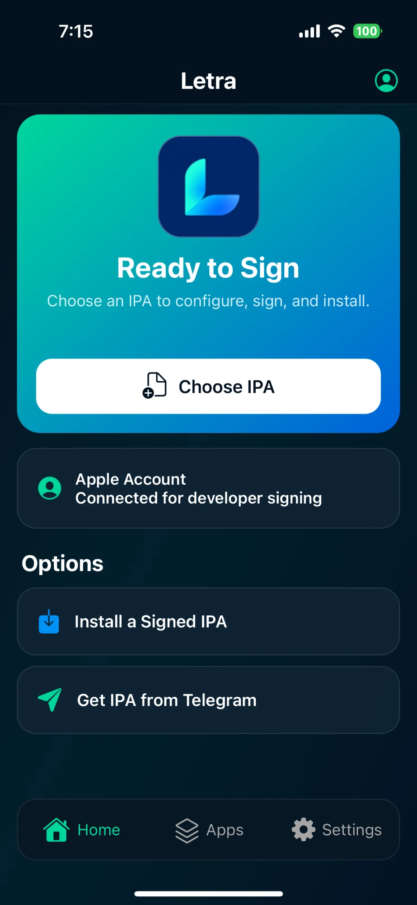
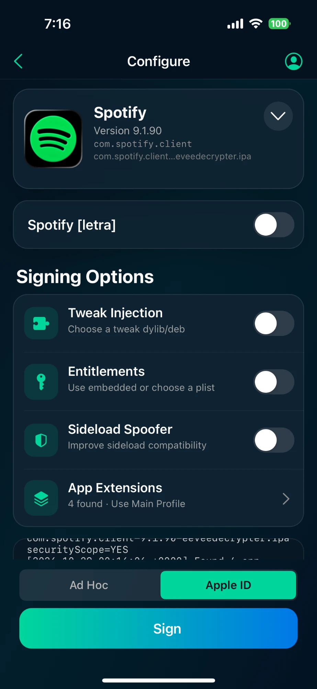
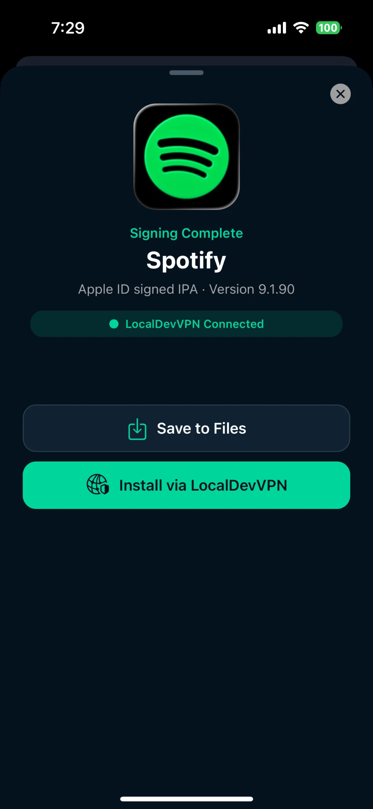
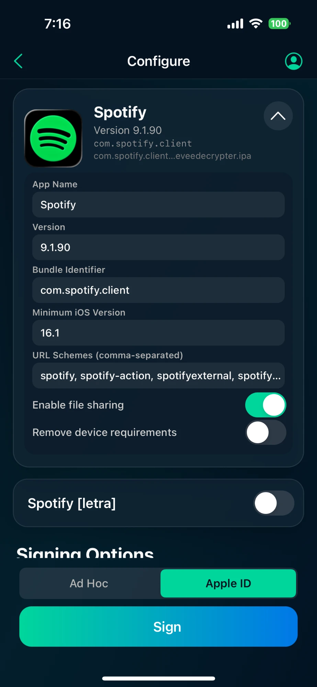
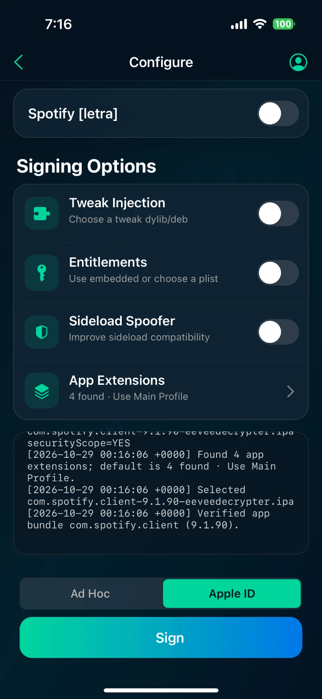
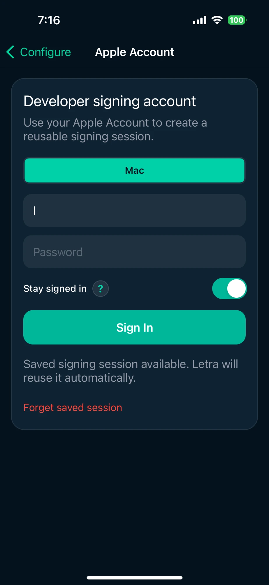

<p align="center">
  
</p>

<h1 align="center">Letra</h1>

<p align="center">
  An on-device IPA signer and installer for iOS. Inject tweaks, re-sign with your Apple ID or ad hoc, and install — no computer required.
</p>

<p align="center">
  
  
  
</p>

---

## Features

- **Sign IPAs on device** with either:
  - **Apple ID** — a free Personal Team or paid developer account. Letra creates the certificate, registers your device, and downloads provisioning profiles for you.
  - **Ad Hoc** — for installation through TrollStore.
- **Tweak injection** — add `.dylib` files or import `.deb` packages; resource bundles inside the package are included automatically.
- **Entitlements** — keep the app's embedded entitlements or pick your own `.plist`.
- **App extensions** — keep, remove, or choose individual extensions, and sign retained ones with the main profile or their own.
- **App metadata** — change the display name, bundle identifier, and version before signing.
- **Two ways to install**
  - **TrollStore** — one-tap handoff for ad hoc builds.
  - **LocalDevVPN** — install Apple ID-signed apps directly on device using your Remote Pairing file.
- **Apps library** — every app installed through Letra is saved so you can **Resign & Reinstall** before the free 7-day profile expires.
- **Stay signed in** — optionally store your Apple ID password securely in the device Keychain so expired sessions renew in the background while re-signing.
- **Get IPA from Telegram** — sign in to Telegram inside Letra, paste an App Store link, and the IPA returned by the bot opens straight into the signing flow.
- **Automatic updates** — Letra checks for new releases, shows what's new, and installs the update for you.

---

## Requirements

- iOS 15.0 or later
- **For Ad Hoc signing:** [TrollStore](https://github.com/opa334/TrollStore)
- **For Apple ID signing:** an Apple ID, plus [LocalDevVPN](#localdevvpn-setup) and a Remote Pairing file to install
- **For Get IPA from Telegram:** a Telegram account

---

## Installation

1. Download `letrainstaller.ipa` (or `.tipa`) from the [latest release](../../releases/latest).
2. Open it with TrollStore, or sideload it with your preferred method.
3. Import a lockdown pairing file in Letra Settings from [iLoader](https://iloader.app/) or [idevice_pair](https://github.com/jkcoxson/idevice_pair) if < iOS 17.4 on a computer.
4. If running iOS 17.4+ use [idevice_pair](https://github.com/jkcoxson/idevice_pair) to get the RPPairing file and import in Letra Settings.
5. Also if running iOS 17.4+ copy your UDID for entering later in Letra Settings.

After that, Letra keeps itself up to date — see [Updates](#updates).

---

## Usage

### Sign and install an app

<p align="center">
  
  
</p>

1. Tap **Choose IPA** on the home screen and pick an `.ipa` file.
2. On the **Configure** screen, choose the signing method at the top: **Ad Hoc** or **Apple ID**.
3. Optionally:
   - Turn on **Tweak Injection** and add `.dylib` or `.deb` files.
   - Choose an **Entitlements** file.
   - Edit the app name, bundle identifier, or version.
   - Pick which **App Extensions** to keep.
4. Tap **Sign**.
5. When signing finishes, choose how to install:
   - **Install with TrollStore** (Ad Hoc)
   - **Install with LocalDevVPN** (Apple ID)
   - **Save to Files** to keep the signed IPA

### Sign in with your Apple ID

<p align="center">
  
</p>

1. Tap the account icon in the top-right of the home screen.
2. Enter your Apple ID and password.
3. Turn on **Stay signed in** if you want Letra to renew your session automatically when it expires. Your password is stored only in this device's Keychain and never leaves it.
4. Enter the verification code if Apple asks for one.

The first Apple ID signing also needs your device's UDID. Letra reads it from your Remote Pairing file if one is imported; otherwise it walks you through installing a short-lived profile to read it.

### Resign apps before they expire

<!-- Screenshot: docs/screenshots/apps.png (Apps library)
<p align="center">
  
</p>
-->

Free Apple ID profiles last 7 days.

1. Open the **Apps** tab.
2. Tap an app and choose **Resign & Reinstall**.

Letra re-signs the saved copy with a fresh profile and installs it again, keeping your tweaks and settings. With **Stay signed in** on, an expired Apple session is renewed in the background — the only prompt you might see is a verification code.

### Install an already-signed IPA

Tap **Install a Signed IPA** under **Options** on the home screen, pick the file, and choose an install method.

### Get an IPA from Telegram

<!-- Screenshots: docs/screenshots/telegram-login.png and telegram-link.png
<p align="center">
  
  
</p>
-->

1. Tap **Get IPA from Telegram** under **Options** on the home screen.
2. Sign in: enter your phone number, the login code Telegram sends you, and your two-step verification password if you have one.
3. Paste an App Store link (Letra fills it in automatically if one is on your clipboard) and tap **Get IPA**.
4. When the IPA arrives, it opens on the Configure screen ready to sign.

You stay signed in to Telegram until you tap **Sign Out**.

---

## LocalDevVPN setup

LocalDevVPN installs apps through your device's own developer services, so Apple ID-signed apps can be installed without a computer. It needs a **pairing file** — a small file that proves your device trusts the installer.

Creating the pairing file needs a computer **once** (a borrowed Mac or PC is fine). After that, everything happens on your device.

### 1. Create the pairing file

Before you start: set a passcode on your device, keep it **unlocked on the home screen**, and connect it to the computer with a USB cable. Tap **Trust** if your device asks.

<details>
<summary><b>Option A — iloader</b> (Windows, macOS, Linux · easiest)</summary>

1. Download and open [iloader](https://github.com/nab138/iloader).
2. Select your device in the device list and tap **Trust** on your device if prompted.
3. Click **Manage Pairing File** and export or save the pairing file.

</details>

<details>
<summary><b>Option B — jitterbugpair</b> (Windows, macOS, Linux · command line)</summary>

1. Download `jitterbugpair` for your computer from the [Jitterbug releases](https://github.com/osy/Jitterbug/releases).
   - **Windows:** iTunes (or Apple Devices) must be installed.
   - **Linux:** `usbmuxd` must be running.
2. Run it with your device connected and unlocked:
   ```bash
   ./jitterbugpair
   ```
3. It saves a file named after your device's UDID, ending in `.mobiledevicepairing`.
   - **Windows:** if the file ends in `.mobiledevicepair`, rename it to end in `.mobiledevicepairing`.

</details>

<!-- TODO: add the on-device (no computer) method once confirmed, including which iOS versions it supports. -->

### 2. Import it into Letra

1. Send the file to your device — AirDrop, iCloud Drive, email, or any cloud storage works.
2. Either open the file and choose **Letra** from the share sheet, or in Letra open **Settings → Import Pairing File** and pick it.

Letra also reads your device's UDID from the pairing file, so you can skip the UDID profile step during Apple ID setup.

### 3. Install apps

Turn on **LocalDevVPN**, then choose **Install with LocalDevVPN** after signing.

> **Note:** A pairing file can stop working after an iOS update, a device reset, or occasionally on its own. If installs start failing, create a new pairing file and import it again.

---

## Updates

<!-- Screenshot: docs/screenshots/update.png (update sheet)
<p align="center">
  
</p>
-->

Letra checks for a new release when it opens (at most every few hours). When one is available you'll see the new version and its release notes, and can install it right away. Some updates are marked as required and must be installed to keep using Letra.

---

## Credits

- [TrollStore](https://github.com/opa334/TrollStore) by opa334
- [ldid](https://github.com/ProcursusTeam/ldid) and [ChOma](https://github.com/opa334/ChOma)
- [SideStore](https://github.com/SideStore/SideStore) and [AltSign](https://github.com/rileytestut/AltSign) for Apple developer services research
- [TDLib](https://github.com/tdlib/td) by Telegram
- [minimuxer](https://github.com/SideStore/minimuxer)

---

## Disclaimer

Letra is intended for installing apps you own or are entitled to use. Respect app developers' licenses and the App Store terms. Letra is not affiliated with Apple or Telegram.
